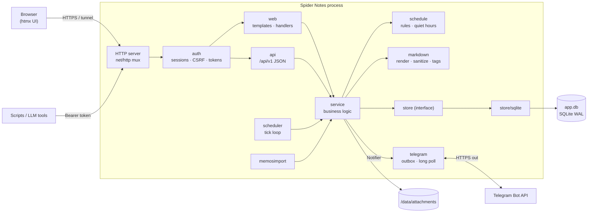
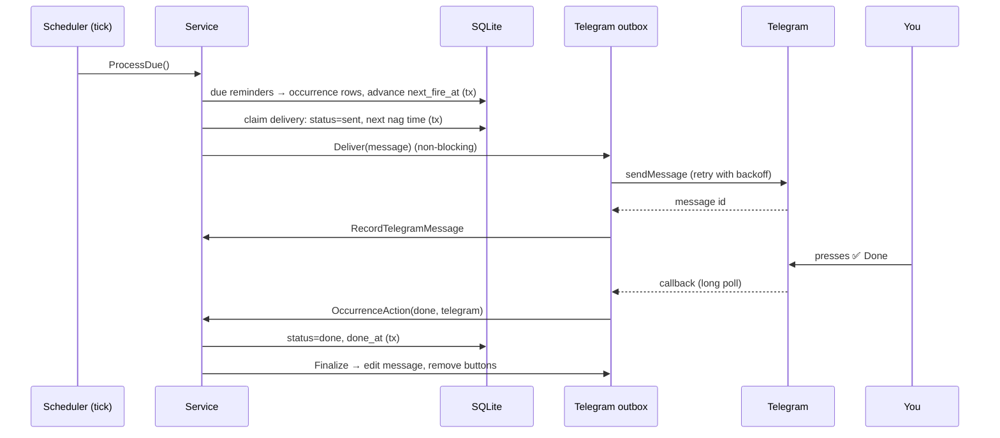

# Architecture

Spider Notes is a single Go process. One binary serves the web UI and the JSON
API, runs the reminder scheduler and talks to Telegram. All state lives in one
SQLite database plus a folder of uploaded files.

## Component diagram

## Packages

| Package | Responsibility |
|---|---|
| `cmd/app` | Entry point: `serve`, `backup`, `import-memos`, `healthcheck`, `version`; wiring and graceful shutdown |
| `internal/config` | Reads and validates environment variables |
| `internal/model` | Domain types and shared errors |
| `internal/store` | Persistence **interfaces** (`store.Store`) |
| `internal/store/sqlite` | SQLite implementation, embedded migrations, FTS5 search |
| `migrations` | Numbered `.sql` files embedded into the binary |
| `internal/schedule` | Recurrence rules (RRULE subset), next-fire calculation, quiet-hour windows |
| `internal/service` | All use cases: tasks, reminders, occurrences, delivery engine, memos, notes, folders, attachments, calendar, history, export, import |
| `internal/scheduler` | Background loop calling `ProcessDue` and the daily export |
| `internal/telegram` | Implements `service.Notifier`; outbox worker with retries; long-polling button handler |
| `internal/auth` | argon2id passwords, server-side sessions, CSRF, login rate limit, API tokens |
| `internal/web` | HTML handlers, embedded templates and static assets, security headers |
| `internal/api` | JSON API under `/api/v1` |
| `internal/markdown` | goldmark rendering, bluemonday sanitising, checkbox toggling, `#tag` parsing |
| `internal/memosimport` | Read-only importer for Memos databases |

Dependencies point inward: handlers → service → store interface. The service
never imports the SQLite package, so another database (e.g. PostgreSQL) only needs
a new `store.Store` implementation.

## Request flow (web)

1. `SecurityHeaders` adds CSP and related headers; a body-size limit wraps every request.
2. `auth.RequireWeb` loads the session from the signed cookie, enforces the idle timeout
   and checks the CSRF token on state-changing requests.
3. The handler calls a service method, which validates input and runs inside a database transaction.
4. The handler renders a full page, or an htmx fragment for partial updates.

## Reminder flow

## Key design decisions

| Decision | Reason |
|---|---|
| **SQLite** with one connection, WAL, foreign keys | A single user needs no database server; one connection serialises writers and avoids lock-upgrade errors. |
| **State before side effects** | Every transition is committed before a message is queued, so restarts never double-send. A unique index on (reminder, scheduled time) makes materialisation idempotent. |
| **Explicit occurrence rows** | History is a first-class record; nothing is overwritten or hard-deleted. |
| **Own recurrence engine** | Precise control over month-end fallback, active windows and counts, while still storing standard RRULE strings. |
| **Long polling** | Works behind firewalls and NAT with no public endpoint. |
| **Server-rendered UI + htmx** | No build step, a small surface, works under a strict CSP with no inline scripts. |
| **Everything embedded** | Templates, CSS, JS, icons, migrations and the OpenAPI file are in the binary: one artifact to deploy. |
| **Uploads by random key** | User file names are never used as paths; files are streamed to disk with a size limit and hashed (SHA-256). |
