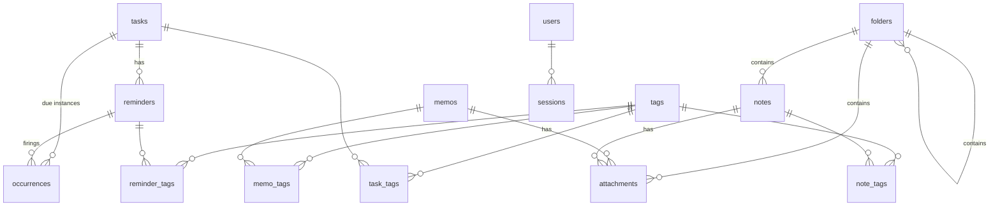

# Data Model

SQLite database at `APP_DB_PATH`. The schema is created by the embedded
migrations in [`migrations/`](../migrations) and tracked in `schema_migrations`.

## Conventions

- **Timestamps** are UTC text in the fixed format `YYYY-MM-DDTHH:MM:SSZ`, so text
  comparison equals time comparison. They are converted to `APP_TIMEZONE` for display.
- **Soft delete**: tasks, reminders, memos, folders, notes and attachments have
  `deleted_at`. Rows are hidden, never removed, so history stays intact.
- **Booleans** are `INTEGER` 0/1.
- **Full-text search** uses FTS5 tables (`memos_fts`, `tasks_fts`, `reminders_fts`,
  `notes_fts`) kept in sync by triggers.

## Entity relationships

## Tables

### Account and settings

| Table | Columns | Notes |
|---|---|---|
| `users` | id, username, password_hash, created_at | One row; argon2id PHC hash |
| `sessions` | id_hash, user_id, csrf_token, created_at, last_seen_at | Cookie token stored as SHA-256 only |
| `api_tokens` | id, name, token_hash, last_used_at, created_at, revoked_at | Token stored as SHA-256 only |
| `settings` | key, value | Quiet hours, snooze time, nag default, export, Telegram |

### Tasks and reminders

| Table | Key columns |
|---|---|
| `tasks` | title, description_md, start_at, due_at, alert (`''`/`start`/`due`/`5m`…`1d`), next_alert_at, priority (`low`/`normal`/`high`), status (`pending`/`done`), repeat_rule (RRULE), repeat_start_at, completed_at, deleted_at |
| `reminders` | task_id (nullable), message_md, schedule_type (`one_time`/`repeating`), fire_at (time or series start), repeat_rule, active_window, timezone, nag_enabled, nag_interval_min, quiet_hours_override (`''`/`off`/`HH:MM-HH:MM`), ignore_quiet_hours, enabled, next_fire_at, last_sent_at, fire_count, deleted_at |
| `occurrences` | reminder_id / task_id, scheduled_for, status (`pending`/`sent`/`done`/`snoozed`/`skipped`/`missed`), sent_count, snooze_count, snoozed_until, next_send_at, last_sent_at, done_at, action_source (`web`/`telegram`/`api`/`system`), telegram_chat_id, telegram_message_id |

Unique indexes on `occurrences(reminder_id, scheduled_for)` and, for reminder-less
task rows, `(task_id, scheduled_for)` make the scheduler idempotent.

### Notes and files

| Table | Key columns |
|---|---|
| `memos` | content_md, pinned, created_at, updated_at, deleted_at |
| `folders` | parent_id (nullable = top level), name, deleted_at |
| `notes` | folder_id (nullable = top level), title, content_md, pinned, deleted_at |
| `attachments` | folder_id / memo_id / note_id, filename, mime, size, sha256, storage_key, deleted_at |

An attachment with no folder, memo or note belongs to the top level of **Folders**.
`storage_key` is `YYYY/MM/<random>.<ext>` under `APP_ATTACHMENTS_DIR`.

### Tags

`tags(id, name UNIQUE)` with join tables `task_tags`, `reminder_tags`, `memo_tags`,
`note_tags`. Memo and note tags are parsed from `#tags` in the text; task and
reminder tags are entered in a field. Tag names are lower-case.

### Expenses
| Table | Key columns | Notes |
|---|---|---|
| `expenses` | item, amount_minor, currency (`USD`/`KHR`/`THB`/`EUR`), category, payment, note, spent_at, deleted_at | |
| `expense_categories` | name (unique, case-insensitive), emoji, position | The category picker. Presets are added by the migration; `expenses.category` stores the name as text |

`amount_minor` is an integer in the currency's smallest unit (USD cents, KHR riel), so
totals are exact. The API also returns it as a decimal string in `amount`.

### Imports

| Table | Columns | Purpose |
|---|---|---|
| `imports` | source, source_key, target_kind, target_id, imported_at | Prevents duplicates when an import is run again |

## Indexes

`reminders(next_fire_at)`, `occurrences(status, scheduled_for)`,
`occurrences(next_send_at)`, `tasks(due_at, status)`, `memos(created_at)`,
`folders(parent_id)`, `notes(folder_id)`, and `attachments(folder_id / memo_id / note_id)`.
