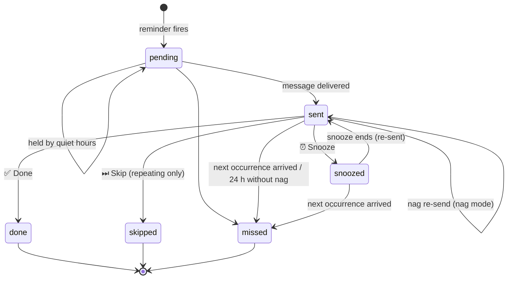

# Reminders & Scheduling

This document describes exactly how reminders and repeating tasks are
scheduled and delivered. All wall-clock calculations use `APP_TIMEZONE`;
timestamps are stored in UTC.

## Schedule types

| Type | Fires | Notes |
|---|---|---|
| One time | At the chosen date and time | Cannot be created more than a minute in the past |
| Daily | Every *N* days at HH:MM | |
| Weekly | On chosen weekdays at HH:MM, every *N* weeks | Weeks start on Monday |
| Monthly | On day *D* at HH:MM, every *N* months | If the month is shorter, fires on its **last day** (31 → 30 Apr, 28/29 Feb) |
| Hourly | Every *N* hours from the start time | Optional active window |
| Minutely | Every *N* minutes from the start time (*N* ≥ 5) | Optional active window |

Common options:

- **Starts on**: the series start. The first occurrence is the first matching time at or after it.
- **Ends on**: last day included (in local time).
- **Max times**: total number of occurrences counted from the start.
- **Active window** (hourly/minutely only): e.g. 08:00–20:00; the end is inclusive, and
  windows may cross midnight (22:00–02:00).

Rules are stored as an RFC 5545 RRULE subset, for example
`FREQ=WEEKLY;INTERVAL=2;BYDAY=MO,WE;BYHOUR=9;BYMINUTE=0;UNTIL=20261231T165959Z`.
The active window is stored separately because it is not part of RFC 5545.

Repeating **tasks** support daily, weekly and monthly rules; their time of day is
taken from the due time.

## The scheduler

A background loop runs every `APP_SCHEDULER_INTERVAL` (default 30 s). Each tick:

1. **Materialises due reminders**: for each enabled reminder with `next_fire_at ≤ now`,
   creates an occurrence row and advances `next_fire_at`.
2. **Processes due tasks**: records task occurrences and advances overdue repeating tasks.
3. **Expires stale occurrences** (see *missed* below).
4. **Delivers** occurrences whose `next_send_at ≤ now`, applying quiet hours and nag mode.
5. Runs the **daily Markdown export** if enabled and due.

Every state change is committed to the database **before** a message is queued
for Telegram. A restart therefore never sends a message twice, and never loses one
that was already scheduled.

## Occurrence lifecycle

| Status | Meaning |
|---|---|
| `pending` | Due, not yet delivered (possibly held by quiet hours) |
| `sent` | Delivered at least once, waiting for an answer |
| `snoozed` | Postponed; re-sent at `snoozed_until` |
| `done` | Completed (records `done_at` and the source: web, telegram, api) |
| `skipped` | Skipped (repeating items only), or closed because its reminder was deleted |
| `missed` | Not answered in time (see below) |

An occurrence becomes **missed** when:

- the **next occurrence** of the same reminder arrives while it is still open, or
- it is **24 hours old**, still open, and its reminder is **not** in nag mode.

Occurrence rows are never deleted. Deleting a reminder or task only hides it,
so its history stays intact.

## Nag mode

With nag mode on, a delivered occurrence is re-sent every *N* minutes until it is
marked Done or Snoozed. Each re-send carries a counter, e.g. “(reminder #3)”, and
removes the buttons from the previous message so only the latest one is active.
Nag re-sends respect quiet hours.

## Quiet hours

- **Global** quiet hours are set in Settings (empty = disabled).
- Each reminder can **use the global setting**, have **none**, or use a **custom window**.
- **Ignore quiet hours** always sends immediately.

A message due inside quiet hours is held (status `pending`) and delivered when the
window ends. Example with 22:00–06:30: a reminder due at 23:15 arrives at 06:30.

## Snooze

| Option | Next delivery |
|---|---|
| 10 minutes / 30 minutes / 1 hour | now + duration |
| Tomorrow morning | tomorrow at the configured “snooze morning” time (default 07:00) |

Telegram offers 10 minutes and 1 hour; the web app offers all four.

## Downtime and catch-up

If the server was off when reminders were due, only the **most recent** missed
occurrence of each reminder is delivered on start-up (one catch-up message).
Older ones are recorded as `missed` (up to 50 per reminder) so the history stays truthful.

## Pausing, resuming and editing

- **Pause** stops deliveries; open occurrences stay open.
- **Resume** schedules from the current time. Occurrences that would have fired while paused
  are not sent. A one-time reminder whose time passed while paused fires once, immediately.
- **Editing** the schedule recalculates `next_fire_at` immediately.

## Reminders attached to tasks

- The Telegram message includes the task title.
- Pressing **Done** on the reminder also completes the task when it has no due date
  or is due on or before the reminder's day (for repeating tasks, the current occurrence).
- Completing the task directly stops the nags of its reminders.
- If the task is already done or deleted when a reminder fires, no message is sent.

## Repeating tasks

- Completing or skipping records the occurrence and moves `due_at` to the next occurrence.
  When the series ends (end date or count reached), the task becomes `done`.
- If a repeating task is still open when its next occurrence arrives, the old occurrence
  is recorded as `missed` and the task moves on.
